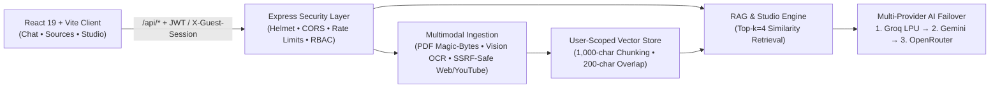

<div align="center">

# ⚡ Nexus Intelligence (NI) — Multimodal AI Knowledge Hub

**Fullstack Retrieval-Augmented Generation (RAG) & Interactive Notebook Studio for PDFs, Images, Web Links & YouTube Videos**


</div>

---

## 📖 Overview

**Nexus Intelligence (NI)** is a fullstack Multimodal RAG workspace and interactive Notebook Studio. Users can ingest **PDF documents**, **images and technical diagrams (Vision OCR)**, **web articles**, and **YouTube videos**, inspect extracted vector chunks, ask strictly grounded questions with verified passage citations, and generate 7 types of interactive study & presentation artifacts.

---

## 🏗️ System Architecture



---

## 🌟 Key Capabilities

### 1. 📄 Multimodal Knowledge Ingestion
- **PDF Documents**: Upload PDFs up to **25 MB** with `%PDF-` magic-byte verification, `pdf-parse` text extraction, and automatic semantic chunking (`1,000` characters with `200`-character overlap).
- **Images & Diagrams (Vision OCR)**: Upload PNG, JPEG, WebP, GIF, or BMP images up to **30 MB** (or paste directly with `Ctrl+V`). Verified via file signatures and analyzed with multimodal Vision OCR to extract verbatim text, diagram structures, tables, and numeric metrics.
- **Web Links & YouTube Videos**:
  - **YouTube**: Fetches video metadata via oEmbed and real captions via `youtube-transcript` (with AI synthesis fallback when captions are unavailable).
  - **Web Pages**: Strips `<script>`, `<style>`, `<nav>`, and `<footer>` tags, extracts readable text, and indexes it into your private session.
- **Source Inspector & Selection**: Select/deselect individual sources for targeted queries and inspect every indexed vector chunk in the Source Inspector modal.

### 2. 💬 Grounded Conversational Q&A
- **Top-k=4 Semantic Retrieval**: Scores and ranks chunks across all active PDFs, images, and links for the current user or isolated guest session.
- **Verified Citations Drawer**: Every response includes expandable source cards displaying source type, name, relevance score, and exact matched passage text.
- **Strict Grounding**: Explicitly refuses to fabricate answers when information is absent from the uploaded sources.

### 3. ✨ Interactive Notebook Studio (7 Tools + Notes)
- **Audio Overview**: Dynamic 2-host (*Alex* & *Jordan*) deep-dive podcast script with browser speech playback.
- **Slide Deck**: Structured multi-slide keynote deck with bullets, visual concepts, and presenter speaker notes.
- **Mind Map**: Multi-tiered radial mind map with interactive node exploration and Mermaid diagram view.
- **Reports**: Structured executive research report grounded in active sources.
- **Flashcards**: Interactive 3D-flipping study cards with difficulty levels and shuffling.
- **Quiz**: Multiple-choice comprehension checks with instant scoring and rationales.
- **Infographic**: Data visualization dashboard with hero metrics, gauges, comparison bars, trends, and pillars.
- **Studio Notes**: Persistent workspace notes saved alongside generated studio artifacts.

### 4. ⚡ Multi-Provider AI Failover Engine
Automatically routes and fails over across configured providers:
1. **Groq Cloud (LPU)** — ultra-low-latency text and vision inference
2. **Google Gemini** (`gemini-3.5-flash`, `gemini-3.6-flash`, `gemini-flash-latest` with automatic 60s `429` cooldown failover)
3. **OpenRouter** — free-tier model fallback

---

## 🛡️ Security Architecture

- **Secrets & Environment Isolation**: Zero hardcoded API keys or admin passcodes in source code; all secrets reside in `server/.env` (excluded via `.gitignore`).
- **Authentication & RBAC**:
  - Passwords hashed with `bcrypt` (**12 salt rounds**, with automatic cost-12 rehashing on sign-in for legacy accounts) and timing-attack mitigation on unknown emails.
  - `HS256`-pinned JWT authentication (`7d` expiry) validated against live user records in `server/data/users.json` (atomic writes with `0o600` permissions).
  - Role-Based Access Control (`requireAdmin`) protecting `/api/admin/*`, with admin registration gated by a timing-safe `ADMIN_INVITE_CODE` check.
- **Per-User & Guest Isolation (Anti-IDOR)**: Every source, chunk inspection (`GET /api/sources/:id/chunks`), deletion, chat, and studio endpoint enforces ownership verification for authenticated users or `crypto.randomUUID()`-backed `X-Guest-Session` isolation.
- **XSS, Input & Upload Validation**:
  - Frontend markdown rendering escapes all HTML entities (`escapeHtml`) and validates external origin links (`http:`/`https:` only).
  - Backend strips control characters and HTML angle brackets, validates route IDs, enforces strict MIME + extension + **magic-byte file signatures** on uploads, and sanitizes production error responses (`NODE_ENV=production`).
- **SSRF & DNS-Rebinding Guard**: Blocks `localhost`, `.local`/`.internal`, private IPv4/IPv6 ranges (`10.0.0.0/8`, `172.16.0.0/12`, `192.168.0.0/16`, `169.254.0.0/16`, `100.64.0.0/10`, `::1`, `fe80::`, `fc00::/7`), resolves DNS before fetching to block rebinding, disallows redirects (`redirect: 'error'`), and caps remote HTML fetches at `2 MB`.
- **Headers, CORS & Rate Limiting**: Strict `helmet` security headers (`X-Frame-Options: DENY`, `nosniff`, API CSP `default-src 'none'`, HSTS in production), explicit origin allowlist CORS, and tiered `express-rate-limit` policies (`authLimiter`, `aiLimiter`, `apiLimiter`).

---

## 📁 Project Structure

```text
NI/
├── client/                     # React 19 + Vite 8 frontend
│   ├── src/
│   │   ├── components/         # Navbar, SourcesDrawer, ChatArea, ChatInput, NotebookStudio, Modals
│   │   ├── pages/              # SignInPage, SignUpPage
│   │   ├── App.jsx             # Workspace state, routing, panel resizing & API integration
│   │   └── index.css           # Dark/Light theme design system
│   ├── index.html
│   ├── package.json
│   └── vite.config.js          # Dev server (port 5173) & /api proxy to port 5000
├── server/                     # Node.js + Express backend
│   ├── data/                   # Isolated local user store (users.json ignored by Git)
│   ├── .env.example            # Environment configuration template
│   ├── package.json
│   └── server.js               # Auth, RBAC, RAG engine, AI failover & security middleware
├── dev.js                      # Concurrent local runner for server + client
├── package.json                # Root scripts (dev, start, server, client, build)
└── vercel.json                 # Multi-service Vercel deployment & static security headers
```

---

## ⚙️ Environment Configuration

Copy `server/.env.example` to `server/.env` and configure your values:

| Variable | Required | Description |
| --- | --- | --- |
| `PORT` | No | Backend server port (default: `5000`) |
| `NODE_ENV` | Yes | Set to `production` to disable debug error details and enable HSTS |
| `CLIENT_URL` | Yes | Primary frontend origin for CORS (e.g. `http://localhost:5173`) |
| `ALLOWED_ORIGINS` | No | Comma-separated additional trusted CORS origins |
| `JWT_SECRET` | Yes | High-entropy secret (`>= 32` chars) used to sign `HS256` JWTs |
| `ADMIN_INVITE_CODE` | No | Secret passcode (`>= 16` chars) enabling admin account registration |
| `GROQ_API_KEY` | At least one AI key | Groq Cloud API key (Priority 1) |
| `GROQ_API_KEY_2` | No | Secondary Groq API key for key rotation |
| `GOOGLE_API_KEY` | At least one AI key | Google Gemini API key (Priority 2 / Vision OCR) |
| `GEMINI_MODEL` | No | Preferred Gemini model (default: `gemini-3.5-flash`) |
| `OPENROUTER_API_KEY` | No | OpenRouter API key (Priority 3 fallback) |
| `AI_PROVIDER` | No | Provider preference (`auto` \| `gemini` \| `groq` \| `openrouter`) |

---

## 🚀 Getting Started

### 1. Install Dependencies
```bash
npm --prefix server install
npm --prefix client install
```

### 2. Configure Environment
```bash
cp server/.env.example server/.env
# Fill in JWT_SECRET and at least one AI provider key (GROQ_API_KEY / GOOGLE_API_KEY)
```

### 3. Run Locally
```bash
# Start both Backend (port 5000) and Frontend (port 5173)
npm run dev
```

Or run services individually:
```bash
# Start Backend only
npm run server

# Start Frontend only
npm run client

# Build Frontend for production
npm run build
```

Open **[http://localhost:5173](http://localhost:5173)** in your browser.

---

## 📡 API Reference

| Category | Method & Endpoint | Auth | Purpose |
| --- | --- | --- | --- |
| **Auth** | `POST /api/auth/signup` | Public (`authLimiter`) | Register user (`user` or `admin` with valid invite code) |
| **Auth** | `POST /api/auth/signin` | Public (`authLimiter`) | Authenticate and receive `HS256` JWT |
| **Auth** | `GET /api/auth/me` | JWT (`authLimiter`) | Validate active session and return sanitized profile |
| **Admin** | `GET /api/admin/users` | Admin | List all registered users (password hashes stripped) |
| **Admin** | `GET /api/admin/stats` | Admin | View system uptime, user counts, and vector store totals |
| **Admin** | `DELETE /api/admin/users/:userId` | Admin | Delete a user and purge their indexed sources/chunks |
| **Admin** | `POST /api/admin/clear-all` | Admin | Purge global vector store |
| **Sources** | `GET /api/sources` | User / Guest | List active user's indexed sources & chunk counts |
| **Sources** | `GET /api/sources/:id/chunks` | Owner / Admin | Inspect extracted chunks for an owned source |
| **Sources** | `DELETE /api/sources/:id` | Owner / Admin | Remove an owned source and its chunks |
| **Sources** | `POST /api/clear` | User / Guest | Clear all sources for the active user/guest |
| **Ingest** | `POST /api/ingest-pdf` | User / Guest (`aiLimiter`) | Upload and index a PDF (`<= 25 MB`) |
| **Ingest** | `POST /api/ingest-image` | User / Guest (`aiLimiter`) | Upload and OCR-analyze an image (`<= 30 MB`) |
| **Ingest** | `POST /api/ingest-link` | User / Guest (`aiLimiter`) | Ingest a web URL or YouTube transcript (SSRF-protected) |
| **Ingest** | `POST /api/ingest-text` | User / Guest (`aiLimiter`) | Ingest raw text, markdown, or code (`<= 500,000` chars) |
| **RAG** | `POST /api/chat` | User / Guest (`aiLimiter`) | Ask grounded questions with top-4 passage citations |
| **Studio** | `POST /api/studio/generate` | User / Guest (`aiLimiter`) | Generate Studio outputs (`audio-overview`, `slide-deck`, `mind-map`, `reports`, `flashcards`, `quiz`, `infographic`) |
| **System** | `GET /api/health` | Public | Sanitized server health check |
| **System** | `GET /api/models/providers` | Public | Configured AI provider availability flags |

---

## ☁️ Deployment

Configured for multi-service deployment on **Vercel** via `vercel.json`:
- Routes `/api/(.*)` to the Express service (`server/`).
- Serves the Vite production build (`client/`) with `X-Content-Type-Options`, `X-Frame-Options`, `Referrer-Policy`, and `Permissions-Policy` response headers.
