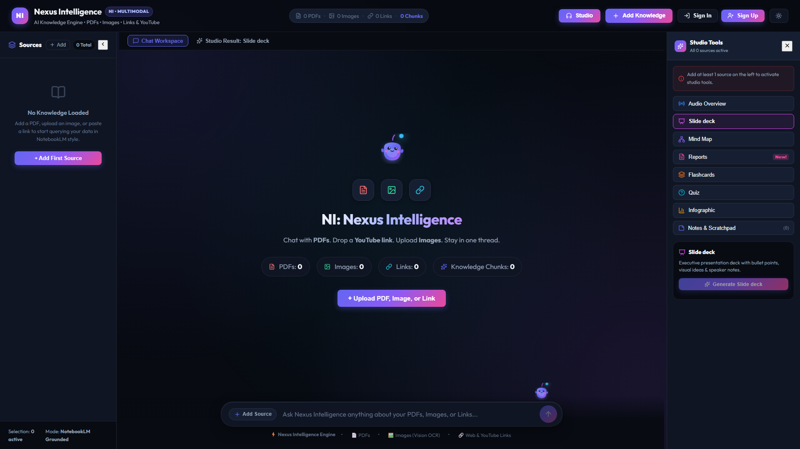
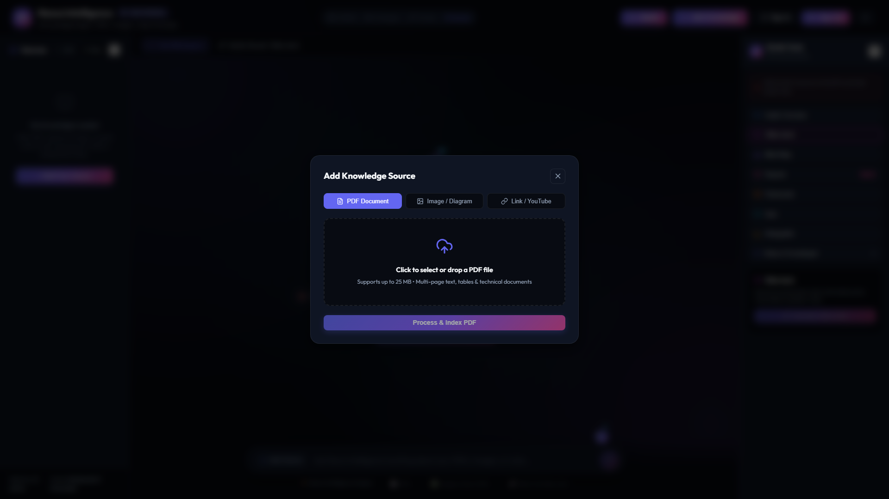
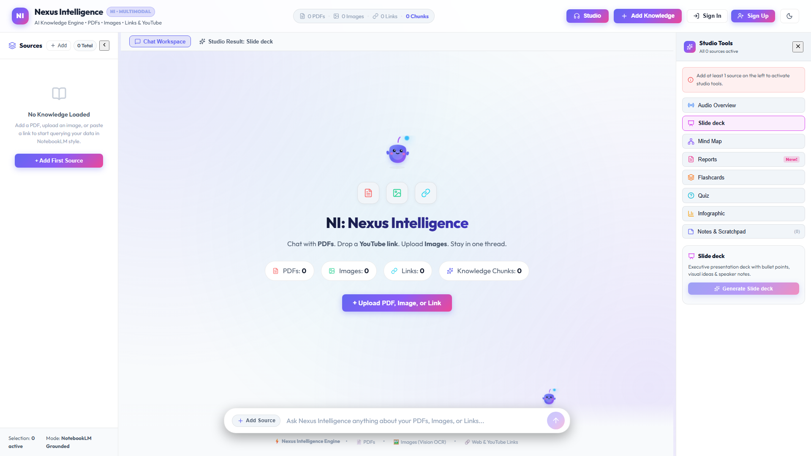
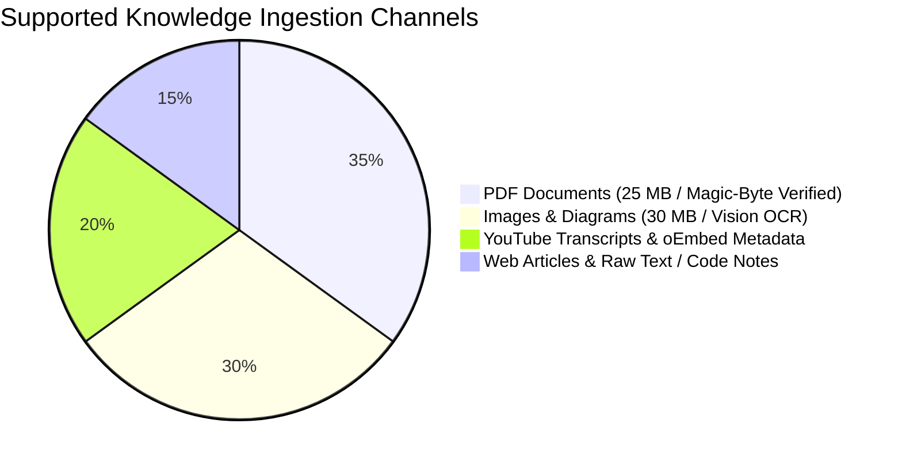
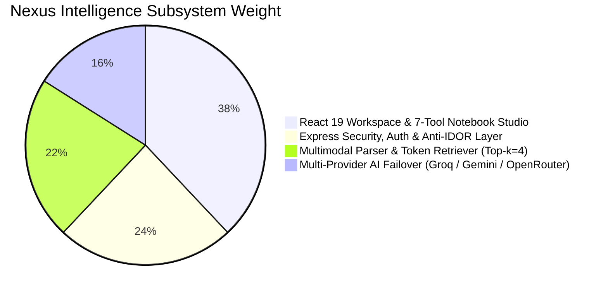
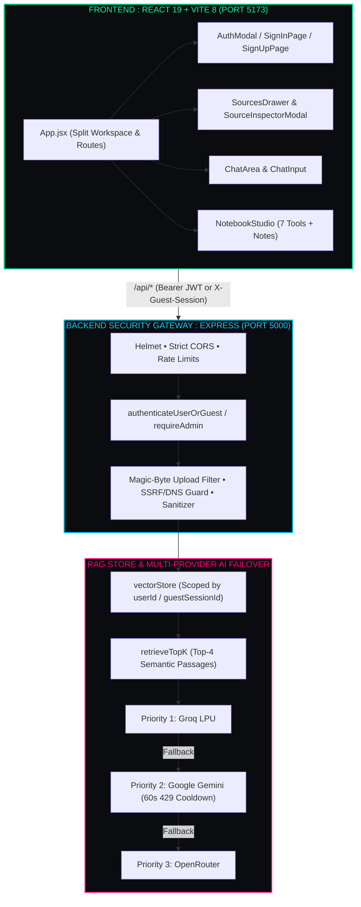

<div align="center">

<h1 style="font-family: 'Cooper Black', 'Arial Black', serif; font-size: 3.8rem; letter-spacing: 2px; color: #00ff99; margin-bottom: 2px; text-shadow: 0 0 25px rgba(0, 255, 153, 0.45);">
  ⚡ NEXUS INTELLIGENCE (NI) ⚡
</h1>

<h3 style="font-family: 'Bookman Old Style', 'URW Bookman', 'Georgia', serif; font-weight: 500; color: #00d4ff; margin-top: 6px; letter-spacing: 0.8px;">
  ◈ <i>Multimodal AI Knowledge Hub &amp; Interactive Notebook Studio</i> ◈
</h3>

<br/>

[](https://react.dev/)
[](https://nodejs.org/)
[](#05-system-architecture)
[](#06-security--hardening-matrix)
[](https://nexusintelligence-ni.vercel.app/)
[](https://priyanshu-pundir.vercel.app/)

<br/>

<p align="center" style="font-family: 'Bookman Old Style', 'URW Bookman', serif; font-size: 1.05rem;">
  <b>✦ <a href="#01-system-overview">Overview</a> ✦</b> &nbsp;•&nbsp;
  <b>✦ <a href="#02-live-hud-preview">UI &amp; Screenshots</a> ✦</b> &nbsp;•&nbsp;
  <b>✦ <a href="#03-pipeline-metrics--charts">Metrics &amp; Charts</a> ✦</b> &nbsp;•&nbsp;
  <b>✦ <a href="#04-multimodal-rag--studio-logic">RAG &amp; Studio Logic</a> ✦</b> &nbsp;•&nbsp;
  <b>✦ <a href="#05-system-architecture">Architecture</a> ✦</b> &nbsp;•&nbsp;
  <b>✦ <a href="#06-security--hardening-matrix">Security Matrix</a> ✦</b> &nbsp;•&nbsp;
  <b>✦ <a href="#07-quick-start">Quick Start</a> ✦</b> &nbsp;•&nbsp;
  <b>✦ <a href="#08-rest-api-endpoints">API Endpoints</a> ✦</b> &nbsp;•&nbsp;
  <b>✦ <a href="#09-more-projects--portfolio">More Projects</a> ✦</b>
</p>

---

</div>

<h2 id="01-system-overview" style="font-family: 'Bookman Old Style', 'URW Bookman', 'Georgia', serif; color: #00ff99;">🌌 01. System Overview</h2>

<p style="font-family: 'Bookman Old Style', 'URW Bookman', serif; font-size: 1.05rem; line-height: 1.7;">
<b>Nexus Intelligence (NI)</b> is a fullstack <b>Multimodal Retrieval-Augmented Generation (RAG)</b> workspace and <b>Interactive Notebook Studio</b> built with <b>React 19</b>, <b>Vite 8</b>, <b>Node.js</b>, and <b>Express</b>. It ingests <b>PDF documents</b>, <b>Images &amp; Diagrams (Vision OCR)</b>, <b>Web Articles</b>, and <b>YouTube Transcripts</b> into a user-isolated vector knowledge base, answers queries with strictly grounded passage citations, and transforms sources into 7 interactive studio artifacts.
</p>

```text
  ┌───────────────────────────┐      ┌───────────────────────────┐      ┌───────────────────────────┐
  │  📄 PDF, Vision & Links   │ ──❯  │ 🧠 User-Scoped Vector DB  │ ──❯  │ ⚡ RAG Chat & 7-Tool Studio│
  │  Magic-Bytes + SSRF Guard │      │  1,000-char Chunk + Index │      │  Groq → Gemini → OpenRouter│
  └───────────────────────────┘      └───────────────────────────┘      └───────────────────────────┘
```

> [!NOTE]
> **Multi-Provider Resilience**: Requests automatically fail over across **Groq Cloud (LPU)**, **Google Gemini** (with 60s `429` cooldown recovery), and **OpenRouter** while keeping every API key isolated on the backend.

---

<h2 id="02-live-hud-preview" style="font-family: 'Bookman Old Style', 'URW Bookman', 'Georgia', serif; color: #00ff99;">📸 02. Live HUD Preview &amp; Screenshots</h2>

<div align="center">

### ◈ 1. Dark Mode Hub — Resizable Sources, Chat Workspace &amp; 7-Tool Studio
<kbd>
  
</kbd>
<br/>
<sub style="font-family: 'Bookman Old Style', 'URW Bookman', serif;"><b>◈ Figure 1.0:</b> Full three-panel workspace featuring the collapsible <b>Sources</b> drawer, central <b>NI</b> chat composer with Nixi mascot, and the <b>Studio Tools</b> panel (Audio Overview, Slide deck, Mind Map, Reports, Flashcards, Quiz, Infographic &amp; Notes).</sub>

<br/><br/>

### ◈ 2. Multimodal Ingestion Modal — PDF, Vision OCR &amp; Link/YouTube Upload
<kbd>
  
</kbd>
<br/>
<sub style="font-family: 'Bookman Old Style', 'URW Bookman', serif;"><b>◈ Figure 1.1:</b> Unified ingestion modal supporting <b>25 MB PDFs</b> (verified with <code>%PDF-</code> signatures), <b>30 MB Images</b> with <code>Ctrl+V</code> clipboard paste &amp; Vision OCR, and <b>SSRF-protected</b> Web/YouTube URLs.</sub>

<br/><br/>

### ◈ 3. Light Mode Workspace — Adaptive Theme &amp; Split-Panel Sync
<kbd>
  
</kbd>
<br/>
<sub style="font-family: 'Bookman Old Style', 'URW Bookman', serif;"><b>◈ Figure 1.2:</b> Instant dark/light mode switching with live source counters (PDFs, Images, Links, Knowledge Chunks), resizable sidebars, and persistent workspace state.</sub>

<br/><br/>

### ◈ 4. Enterprise RAG Search Matrix — Core Retrieval Architecture
<kbd>
  
</kbd>
<br/>
<sub style="font-family: 'Bookman Old Style', 'URW Bookman', serif;"><b>◈ Figure 1.3:</b> Multimodal semantic retrieval pipeline indexing document chunks, OCR diagram breakdowns, and video transcripts for grounded LLM synthesis.</sub>

</div>

---

<h2 id="03-pipeline-metrics--charts" style="font-family: 'Bookman Old Style', 'URW Bookman', 'Georgia', serif; color: #00ff99;">📊 03. Pipeline Metrics &amp; Charts</h2>

### 🥧 Multimodal Input &amp; Studio Tool Coverage


### 🛰️ Application Subsystem Allocation


---

<h2 id="04-multimodal-rag--studio-logic" style="font-family: 'Bookman Old Style', 'URW Bookman', 'Georgia', serif; color: #00ff99;">🔍 04. Multimodal RAG &amp; Studio Logic</h2>

<p style="font-family: 'Bookman Old Style', 'URW Bookman', serif; font-size: 1.02rem;">
Every source passes through validation, semantic chunking (<code>1,000</code> chars, <code>200</code> overlap), and user-scoped indexing before retrieval or Studio generation:
</p>

| Module / Feature | Input &amp; Validation | Processing Engine | Workspace Output |
| :--- | :--- | :---: | :--- |
| **PDF Ingestion** | `.pdf` MIME + `%PDF-` magic bytes (`<= 25 MB`) | `pdf-parse` + sentence-aware chunker | Indexed chunks + Source Inspector preview |
| **Vision OCR** | JPEG/PNG/WebP/GIF/BMP + binary signature (`<= 30 MB`) | Multimodal Vision OCR prompt | Verbatim text, diagram flows &amp; tables |
| **YouTube &amp; Web** | SSRF + DNS-rebinding check (`redirect: 'error'`) | `youtube-transcript` / oEmbed / HTML cleaner | Timestamped transcript or clean article chunks |
| **Grounded Chat** | Sanitized query + active `selectedSourceIds` | `retrieveTopK` (`k = 4`) + strict grounding | Direct answer + expandable Citations drawer |
| **Audio Overview** | Active session chunks + optional focus | 2-host dialogue synthesizer (*Alex* &amp; *Jordan*) | Interactive script + browser speech playback |
| **Slide Deck &amp; Reports** | Active session chunks | Structured JSON deck / Markdown report | Slide navigator w/ speaker notes &amp; report view |
| **Mind Map &amp; Infographic** | Active session chunks | Hierarchical 4-quadrant &amp; KPI JSON extractor | Radial doodle/pastel Mind Map, Mermaid &amp; charts |
| **Flashcards &amp; Quiz** | Active session chunks | Q&amp;A deck &amp; MCQ assessment generator | 3D-flipping study cards &amp; scored interactive quiz |

> [!TIP]
> **Quick Studio Commands**: Typing keywords like `flashcards`, `quiz`, `slide deck`, `mind map`, `infographic`, `audio overview`, or `report` in the chat bar launches the matching Studio generator automatically.

---

<h2 id="05-system-architecture" style="font-family: 'Bookman Old Style', 'URW Bookman', 'Georgia', serif; color: #00ff99;">🧬 05. System Architecture</h2>



---

<h2 id="06-security--hardening-matrix" style="font-family: 'Bookman Old Style', 'URW Bookman', 'Georgia', serif; color: #00ff99;">🛡️ 06. Security &amp; Hardening Matrix</h2>

<details open>
<summary><b>🔒 Authentication, RBAC &amp; Isolation (<code>server/server.js</code>)</b></summary>

| Vector | Protection Applied | Enforcement |
| :--- | :--- | :--- |
| **Password Security** | `bcrypt` with **12 salt rounds**, timing-attack dummy hash, automatic cost-12 upgrade on login | `/api/auth/signup`, `/api/auth/signin` |
| **JWT &amp; Session Integrity** | `HS256`-pinned JWTs validated against live `users.json` records (deleted/demoted users blocked) | `verifyTokenAndLoadUser` |
| **Admin RBAC** | `requireAdmin` middleware + timing-safe (`crypto.timingSafeEqual`) `ADMIN_INVITE_CODE` (`>= 16` chars) | `/api/admin/*` |
| **Anti-IDOR Isolation** | Eliminated shared guest fallback; strict ownership checks on chunk inspection and deletion | `authenticateUserOrGuest` |
| **Guest Session Entropy** | Unguessable `crypto.randomUUID()` session IDs sent via `X-Guest-Session` | `client/src/App.jsx` |

</details>

<details open>
<summary><b>🧱 Network, Upload, XSS &amp; Dependency Hardening (<code>server/server.js</code> · <code>vercel.json</code>)</b></summary>

- **SSRF &amp; DNS-Rebinding Guard:** Blocks `localhost`, `.local`/`.internal`, private IPv4/IPv6 ranges (`10.0.0.0/8`, `172.16.0.0/12`, `192.168.0.0/16`, `169.254.0.0/16`, `100.64.0.0/10`, `::1`, `fe80::`, `fc00::/7`), resolves DNS prior to fetching, blocks HTTP redirects (`redirect: 'error'`), and caps remote HTML reads at `2 MB`.
- **Upload Magic-Byte Validation:** Enforces MIME + extension match **plus** binary signature checks (`%PDF-`, JPEG, PNG, GIF, WebP, BMP) via `multer@2.5.0`.
- **XSS &amp; Input Sanitization:** Strips control chars and angle brackets backend-side; frontend `escapeHtml` escapes markdown tokens and enforces `http:`/`https:` origin links.
- **HTTP Headers, CORS &amp; Rate Limits:** `helmet` (`X-Frame-Options: DENY`, `nosniff`, strict API CSP `default-src 'none'`, HSTS in production), explicit CORS origin allowlist (no wildcard `.vercel.app`), `authLimiter` (`20/15m`), `aiLimiter` (`60/15m`), `apiLimiter` (`300/15m`), `NODE_ENV=production` error masking, and `0 vulnerabilities` on `npm audit`.

</details>

---

<h2 id="07-quick-start" style="font-family: 'Bookman Old Style', 'URW Bookman', 'Georgia', serif; color: #00ff99;">🚀 07. Quick Start</h2>

### 📋 Prerequisites
- **Node.js `v18+`** and **npm**
- At least one AI API key (**Groq**, **Google Gemini**, or **OpenRouter**)

```bash
# 1. Clone the repository
git clone https://github.com/PriyanshuPundir01/Nexus_Intelligence-NI.git
cd Nexus_Intelligence-NI

# 2. Install backend and frontend dependencies
npm --prefix server install
npm --prefix client install

# 3. Configure environment variables (copy template & add your keys)
cp server/.env.example server/.env

# 4. Boot both Backend (port 5000) and Frontend (port 5173)
npm run dev
```

### 🌐 Local Access &amp; Build Commands
- **App URL:** `http://localhost:5173`
- **Backend Only:** `npm run server`
- **Frontend Only:** `npm run client`
- **Lint &amp; Production Build:** `npm --prefix client run lint && npm run build`

---

<h2 id="08-rest-api-endpoints" style="font-family: 'Bookman Old Style', 'URW Bookman', 'Georgia', serif; color: #00ff99;">🔌 08. REST API Endpoints</h2>

<details open>
<summary><b>📡 Auth, Admin, Multimodal Ingestion, RAG &amp; Studio Routes</b></summary>

| Method &amp; Endpoint | Access | Purpose |
| :--- | :--- | :--- |
| `POST /api/auth/signup` · `POST /api/auth/signin` · `GET /api/auth/me` | Public / JWT (`authLimiter`) | Account registration, `HS256` login, and session validation |
| `GET /api/admin/users` · `GET /api/admin/stats` · `DELETE /api/admin/users/:userId` · `POST /api/admin/clear-all` | Admin (`requireAdmin`) | User management, system stats, and global store purge |
| `GET /api/sources` · `GET /api/sources/:id/chunks` · `DELETE /api/sources/:id` · `POST /api/clear` | Owner / Guest | Manage and inspect user-scoped knowledge sources |
| `POST /api/ingest-pdf` · `POST /api/ingest-image` · `POST /api/ingest-link` · `POST /api/ingest-text` | User / Guest (`aiLimiter`) | Ingest PDFs, Vision OCR images, links/YouTube, and text/code |
| `POST /api/chat` · `POST /api/studio/generate` | User / Guest (`aiLimiter`) | Grounded RAG Q&amp;A with citations &amp; 7-tool Studio generation |
| `GET /api/health` · `GET /api/models/providers` | Public | Sanitized health check and provider configuration flags |

</details>

---

<h2 id="09-more-projects--portfolio" style="font-family: 'Bookman Old Style', 'URW Bookman', 'Georgia', serif; color: #00ff99;">🗂️ 09. More Projects &amp; GitHub Repositories</h2>

<p style="font-family: 'Bookman Old Style', 'URW Bookman', serif; font-size: 1.02rem;">
Explore all live demos, interactive 3D architecture specs, and source repositories on my portfolio:
<b><a href="https://priyanshu-pundir.vercel.app/">priyanshu-pundir.vercel.app</a></b>
</p>

| # | Repository | Domain | Highlights |
| :---: | :--- | :--- | :--- |
| **01** | **[N.A.N.U](https://github.com/PriyanshuPundir01/N.A.N.U)** | Multi-Model AI &amp; Voice | Dynamic Gemini Flash / Qwen 2.5 router, Web Speech dictation &amp; multimodal ingest |
| **02** | **[Nexus_Intelligence-NI](https://github.com/PriyanshuPundir01/Nexus_Intelligence-NI)** | Enterprise Multimodal RAG | PDF, Vision OCR, Web/YouTube ingestion, Top-4 citations &amp; 7-tool Notebook Studio |
| **03** | **[DroneTV-AI](https://github.com/PriyanshuPundir01/DroneTV-AI)** | Aerial Ecosystem &amp; CRM | React + Express + MongoDB conversational lead assistant &amp; admin dashboard |
| **04** | **[CryptScale](https://github.com/PriyanshuPundir01/CryptScale)** | Cybersecurity &amp; CSPRNG | Real-time entropy analysis, RTX 4090 attack sim &amp; zero-knowledge breach telemetry |
| **05** | **[MONEYMATRIX](https://github.com/PriyanshuPundir01/MONEYMATRIX)** | Core Banking in C | In-memory Binary Search Tree indexing, 2-phase atomic P2P &amp; salted DJB2 ledger |
| **06** | **[Automotive_Hub](https://github.com/PriyanshuPundir01/Automotive_Hub)** | Full-Stack Discovery UI | Faceted search portal, acceleration telemetry &amp; dynamic `jsPDF` order receipts |
| **07** | **[Sangeet](https://github.com/PriyanshuPundir01/Sangeet)** | Media Streaming &amp; DSP | 35+ regional folk tracks powered by custom Web Audio API &amp; FFT visualizer |
| **08** | **[CyberSentinal](https://github.com/PriyanshuPundir01/CyberSentinal)** | SOC Threat Analyzer | Live packet inspection (`Scapy`), Snort anomaly rules &amp; telemetry analytics |
| **09** | **[ShadowTrace](https://github.com/PriyanshuPundir01/ShadowTrace)** | Endpoint Telemetry HUD | Asynchronous `pynput` hardware daemon streaming into a Flask terminal HUD |

---

<h2 id="10-author--connect" style="font-family: 'Bookman Old Style', 'URW Bookman', 'Georgia', serif; color: #00ff99;">📞 10. Author &amp; Connect</h2>

- **Developer:** Priyanshu Pundir — Full Stack Developer &amp; Systems Engineer
- **Portfolio:** [priyanshu-pundir.vercel.app](https://priyanshu-pundir.vercel.app/)
- **Live App:** [nexusintelligence-ni.vercel.app](https://nexusintelligence-ni.vercel.app/)
- **GitHub:** [github.com/PriyanshuPundir01](https://github.com/PriyanshuPundir01)
- **LinkedIn:** [linkedin.com/in/priyanshupundir01](https://www.linkedin.com/in/priyanshupundir01/)
- **Email:** [priyanshupundir36@gmail.com](mailto:priyanshupundir36@gmail.com)

<div align="center">

---

⭐ **Star this repository if you find Nexus Intelligence (NI) helpful!** ⭐

<p style="font-family: 'Bookman Old Style', 'URW Bookman', serif; color: #64748b; margin-top: 8px;">
  Crafted with ⚡ by <b>Priyanshu Pundir</b>
</p>

</div>
